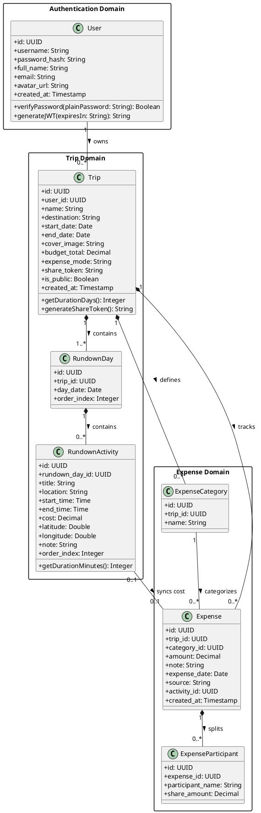
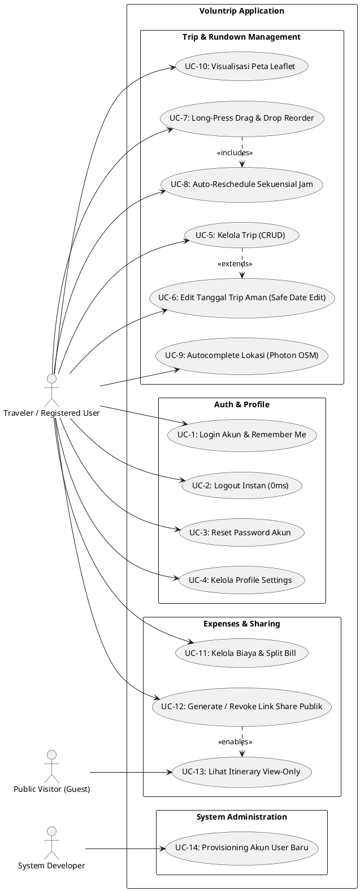
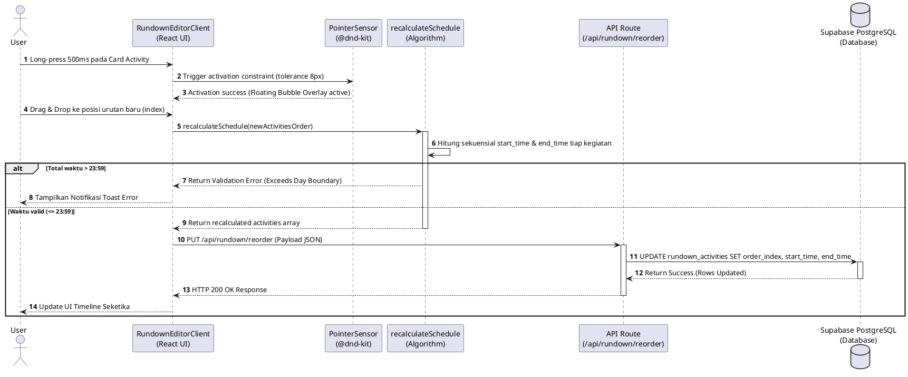
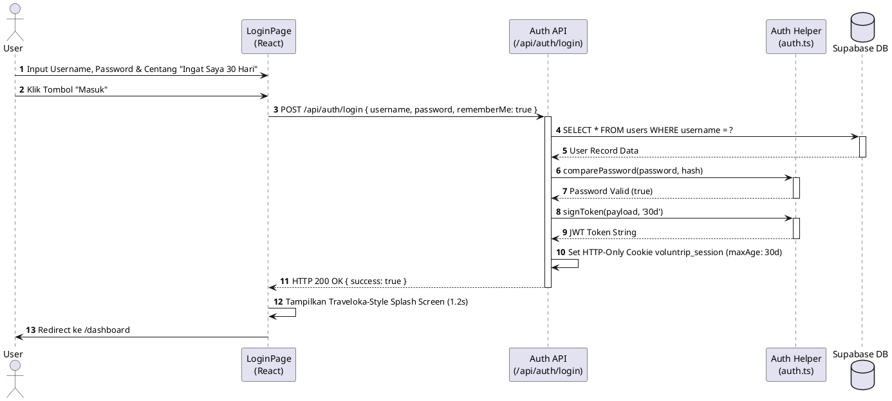

# Product Requirements Document (PRD)
## Voluntrip - Aplikasi Perencanaan Trip, Rundown & Budgeting

**Versi:** 2.0  
**Tanggal:** 29 Juli 2026  
**Status:** Approved & Implemented  
**Pengembang:** Moch Firmansyah  

---

## 📋 Table of Contents
1. [Overview](#1-overview)
2. [Tech Stack](#2-tech-stack)
3. [Goals & Non-Goals](#3-goals--non-goals)
4. [Functional Requirements (FR)](#4-functional-requirements-fr)
5. [Non-Functional Requirements (NFR)](#5-non-functional-requirements-nfr)
6. [Design System & UI/UX Standards](#6-design-system--uiux-standards)
7. [System Architecture & PlantUML Diagrams](#7-system-architecture--plantuml-diagrams)
   - [7.1 Class Diagram](#71-class-diagram)
   - [7.2 Use Case Diagram](#72-use-case-diagram)
   - [7.3 Sequence Diagrams](#73-sequence-diagrams)
   - [7.4 Activity Diagram](#74-activity-diagram)
8. [Database Schema Definition](#8-database-schema-definition)
9. [Folder Structure](#9-folder-structure)
10. [Deployment & Security](#10-deployment--security)

---

## 1. Overview

**Voluntrip** adalah aplikasi perencana perjalanan web (Progressive Web App) modern yang mengintegrasikan perencanaan itinerary/rundown harian interaktif, otomatisasi penjadwalan jam sekuensial bebas tabrakan, autocomplete lokasi peta OpenStreetMap, serta pelacak pengeluaran (*expense tracker*) dan *split bill* kelompok.

Aplikasi ini diciptakan untuk menyelesaikan masalah umum traveler: jadwal bentrok, penghitungan jam manual yang merepotkan, kebingungan koordinat peta, serta transparansi pembagian biaya grup perjalanan.

---

## 2. Tech Stack

* **Frontend Framework**: Next.js 16 (App Router, Turbopack)
* **Bahasa**: TypeScript (100% Strict Type Safety)
* **Styling**: Tailwind CSS, Glassmorphism, Custom Keyframes
* **UI Components**: Lucide Icons, Custom Accessible Components
* **Drag & Drop Reordering**: `@dnd-kit/core` dengan `PointerSensor` (Delay 500ms, Tolerance 8px)
* **Autocomplete & Map**: Photon OpenStreetMap API (`photon.komoot.io`), Leaflet Map
* **Database & Query**: Supabase PostgreSQL (`postgres` SQL client)
* **Autentikasi**: JWT HTTP-Only Cookies, `bcryptjs`
* **PWA Plugin**: `@ducanh2912/next-pwa`
* **Validasi Schema**: Zod (`trip.schema.ts`, `rundown.schema.ts`, `expense.schema.ts`)

---

## 3. Goals & Non-Goals

### 🎯 Core Goals
* **Bebas Bentrok Jam**: Penjadwalan sekuensial otomatis yang menghitung durasi kegiatan tanpa tumpang tindih.
* **Pengalaman Touch Mobile Nyaman**: Drag & drop gelembung melayang dengan long-press 500ms.
* **Kemudahan Akses Lokasi**: Ekstraksi nama tempat & koordinat latitude/longitude secara otomatis.
* **Perhitungan Budget Transparan**: Lacak sisa anggaran & pembagian biaya per peserta.
* **Responsif & Ringan**: Tampilan Traveloka-Style Splash Screen & dukungan PWA standalone.

---

## 4. Functional Requirements (FR)

### 4.1 Autentikasi & Keamanan Sesi
* **FR-1**: User login menggunakan username & password terenkripsi bcrypt.
* **FR-2**: Opsi "Ingat saya selama 30 hari" mengaktifkan cookie persisten `maxAge: 30d`. Tanpa centang, cookie berupa *Session Cookie* (terhapus saat browser ditutup).
* **FR-3**: Fitur Instant Logout (0ms) memicu pembersihan cookie HTTP-Only via request `keepalive`.
* **FR-4**: Reset password akun melalui pencocokan username & email terdaftar.

### 4.2 Manajemen Trip & Pengeditan Tanggal Aman
* **FR-5**: Tambah, edit, dan hapus trip (Nama, Destinasi, Tanggal Mulai, Tanggal Selesai, Budget, Cover Image).
* **FR-6**: Jika pengeditan tanggal mengurangi total durasi hari trip, sistem menampilkan `ConfirmDateChangeDialog` agar user memilih hari mana yang akan dihapus tanpa merusak urutan hari tersisa.

### 4.3 Rundown & Itinerary Interaktif
* **FR-7**: Reorder kegiatan harian via Drag & Drop long-press 500ms dengan visual gelembung melayang (`DragOverlay`).
* **FR-8**: Auto-reschedule otomatis yang menghitung jam kegiatan berikutnya berdasarkan durasi asli kegiatan sebelumnya.
* **FR-9**: Validasi batas 23:59 (reorder ditolak jika akumulasi waktu melebihi batas hari).
* **FR-10**: Autocomplete lokasi berbasis Photon OSM yang otomatis menangkap nilai latitude & longitude.
* **FR-11**: Pre-fill `start_time` kegiatan baru otomatis mengikuti `end_time` kegiatan terakhir.

### 4.4 Pengeluaran & Budgeting
* **FR-12**: Catat pengeluaran manual & otomatis dari kegiatan itinerary.
* **FR-13**: Dukungan mode Split Bill per peserta trip.
* **FR-14**: Penanganan shorthand angka biaya otomatis (misal `200` $\rightarrow$ `200.000` jika $< 10.000$) tanpa bug *auto-multiply* pada mode edit.

### 4.5 Sharing Link Publik
* **FR-15**: Generate link publik menggunakan `share_token` unik untuk tampilan view-only bagi non-user.

---

## 5. Non-Functional Requirements (NFR)

* **NFR-1**: Performance load time $< 1.5$ detik dengan `revalidate = 0` pada rute API dinamis.
* **NFR-2**: Keamanan data password menggunakan salt bcrypt 10 putaran.
* **NFR-3**: PWA Standalone Mode dapat berjalan di iOS dan Android tanpa address bar.
* **NFR-4**: Bebas *hydration mismatch* SSR pada kompilasi Turbopack Next.js 16.

---

## 6. Design System & UI/UX Standards

* **Tema Warna**: Primary `#c17a5f` (Warm Sand/Coral), Accent Teal `#0d9488`, Warm Background `oklch(0.98 0.006 70)`.
* **Visual Animation**: Traveloka-style Splash Screen (Logo & Moving Line Indicator) pada kunjungan web.
* **Mikro-Interaksi**: Scale 1.03x pada kartu yang di-long-press, shadow elevation `shadow-2xl`.

---

## 7. System Architecture & PlantUML Diagrams

### 7.1 Class Diagram
Diagram kelas yang menggambarkan struktur data dan entitas sistem Voluntrip:



---

### 7.2 Use Case Diagram
Diagram use case yang menggambarkan interaksi aktor (User, Public Visitor, Developer) dengan sistem:



---

### 7.3 Sequence Diagrams

#### Sequence 1: Drag & Drop Activity Reorder dengan Auto-Reschedule


#### Sequence 2: User Login & Session Persistence


---

### 7.4 Activity Diagram
Activity Diagram proses penyusunan Rundown & Pengeditan Tanggal Trip Aman (*Safe Date Edit*):

```plantuml
@startuml Voluntrip_Activity_Diagram
skinparam backgroundColor #FFFFFF
start

:User Membuka Halaman Rundown Trip;
:Sistem Memuat Data Days & Activities dari API;

if (Pilihan Aksi User?) then (Drag & Drop Reorder)
  :User Long-Press Card Activity 500ms;
  :Bubble Overlay Aktif;
  :User Menggeser Card ke Urutan Baru;
  :Sistem Menghitung Ulang Jam Sekuensial (recalculateSchedule);
  
  if (Jam Selesai > 23:59?) then (Ya)
    :Batalkan Drag & Tampilkan Notifikasi Error;
  else (Tidak)
    :Kirim Reorder Payload ke API /api/rundown/reorder;
    :Simpan Perubahan ke Database;
    :Update Tampilan Timeline;
  endif

else (Tambah Activity Baru)
  :User Klik "Tambah Agenda";
  :Sistem Auto-Fill start_time dengan end_time Kegiatan Terakhir;
  :User Ketik Lokasi pada LocationAutocomplete;
  :API Photon OSM Mengembalikan Rekomendasi Lokasi & Latitude/Longitude;
  :User Simpan Activity Baru;
  :Simpan Data ke Database;

else (Edit Tanggal Trip)
  :User Mengubah Tanggal Trip di Modal Edit;
  
  if (Total Hari Berkurang?) then (Ya)
    :Tampilkan Modal ConfirmDateChangeDialog;
    :User Memilih Hari yang Ingin Dihapus;
    :Hapus Hari Terpilih & Map Ulang order_index Hari Tersisa;
  else (Tidak)
    :Update Tanggal Trip Langsung;
  endif
  
  :Kirim Request PUT /api/trips/[tripId];
  :Database Update Success;
endif

stop
@enduml
```

---

## 8. Database Schema Definition

Berikut adalah definisi DDL SQL untuk seluruh tabel dalam Supabase PostgreSQL Voluntrip:

```sql
-- 1. Tabel Users
CREATE TABLE IF NOT EXISTS users (
  id UUID PRIMARY KEY DEFAULT gen_random_uuid(),
  username TEXT UNIQUE NOT NULL,
  password_hash TEXT NOT NULL,
  full_name TEXT NOT NULL,
  email TEXT UNIQUE,
  avatar_url TEXT,
  created_at TIMESTAMP WITH TIME ZONE DEFAULT NOW()
);

-- 2. Tabel Trips
CREATE TABLE IF NOT EXISTS trips (
  id UUID PRIMARY KEY DEFAULT gen_random_uuid(),
  user_id UUID NOT NULL REFERENCES users(id) ON DELETE CASCADE,
  name TEXT NOT NULL,
  destination TEXT NOT NULL,
  start_date DATE NOT NULL,
  end_date DATE NOT NULL,
  cover_image TEXT,
  budget_total NUMERIC(12,2) DEFAULT 0,
  expense_mode TEXT DEFAULT 'per_trip',
  share_token TEXT UNIQUE,
  is_public BOOLEAN DEFAULT FALSE,
  created_at TIMESTAMP WITH TIME ZONE DEFAULT NOW()
);

-- 3. Tabel Rundown Days
CREATE TABLE IF NOT EXISTS rundown_days (
  id UUID PRIMARY KEY DEFAULT gen_random_uuid(),
  trip_id UUID NOT NULL REFERENCES trips(id) ON DELETE CASCADE,
  day_date DATE NOT NULL,
  order_index INTEGER NOT NULL,
  created_at TIMESTAMP WITH TIME ZONE DEFAULT NOW()
);

-- 4. Tabel Rundown Activities
CREATE TABLE IF NOT EXISTS rundown_activities (
  id UUID PRIMARY KEY DEFAULT gen_random_uuid(),
  rundown_day_id UUID NOT NULL REFERENCES rundown_days(id) ON DELETE CASCADE,
  title TEXT NOT NULL,
  location TEXT,
  start_time TIME NOT NULL,
  end_time TIME NOT NULL,
  cost NUMERIC(12,2) DEFAULT 0,
  latitude DOUBLE PRECISION,
  longitude DOUBLE PRECISION,
  note TEXT,
  order_index INTEGER NOT NULL,
  created_at TIMESTAMP WITH TIME ZONE DEFAULT NOW()
);

-- 5. Tabel Expense Categories
CREATE TABLE IF NOT EXISTS expense_categories (
  id UUID PRIMARY KEY DEFAULT gen_random_uuid(),
  trip_id UUID NOT NULL REFERENCES trips(id) ON DELETE CASCADE,
  name TEXT NOT NULL,
  created_at TIMESTAMP WITH TIME ZONE DEFAULT NOW()
);

-- 6. Tabel Expenses
CREATE TABLE IF NOT EXISTS expenses (
  id UUID PRIMARY KEY DEFAULT gen_random_uuid(),
  trip_id UUID NOT NULL REFERENCES trips(id) ON DELETE CASCADE,
  category_id UUID REFERENCES expense_categories(id) ON DELETE SET NULL,
  amount NUMERIC(12,2) NOT NULL,
  note TEXT,
  expense_date DATE NOT NULL,
  source TEXT DEFAULT 'manual',
  activity_id UUID REFERENCES rundown_activities(id) ON DELETE CASCADE,
  created_at TIMESTAMP WITH TIME ZONE DEFAULT NOW()
);

-- 7. Tabel Expense Participants
CREATE TABLE IF NOT EXISTS expense_participants (
  id UUID PRIMARY KEY DEFAULT gen_random_uuid(),
  expense_id UUID NOT NULL REFERENCES expenses(id) ON DELETE CASCADE,
  participant_name TEXT NOT NULL,
  share_amount NUMERIC(12,2) NOT NULL,
  created_at TIMESTAMP WITH TIME ZONE DEFAULT NOW()
);
```

---

## 9. Folder Structure

```text
Voluntrip/
├── prd/
│   ├── PRD.md                 # Dokumen PRD Utama & Diagram PlantUML
│   └── README.md              # Ringkasan Eksekutif PRD
├── public/
│   ├── icon-192x192.png       # Ikon PWA 192px
│   ├── icon-512x512.png       # Ikon PWA 512px
│   ├── manifest.json          # Manifest PWA Standalone
│   └── images/
│       └── Logo_voluntrip.png # Asset Logo Utama
├── src/
│   ├── app/
│   │   ├── (auth)/login/page.tsx
│   │   ├── (dashboard)/
│   │   │   ├── dashboard/page.tsx
│   │   │   └── trips/
│   │   │       ├── page.tsx
│   │   │       └── [tripId]/
│   │   │           ├── page.tsx
│   │   │           ├── expenses/_components/ExpensesClient.tsx
│   │   │           └── rundown/_components/RundownEditorClient.tsx
│   │   ├── api/               # Rute API Endpoint (Auth, Trips, Rundown, Expenses, Share, Profile)
│   │   ├── layout.tsx
│   │   └── page.tsx           # Entry Point & Traveloka Splash Handler
│   ├── components/
│   │   ├── shared/            # LocationAutocomplete, SplashScreen, ConfirmDateChangeDialog, SidebarLayout
│   │   └── ui/                # Base Components UI (Button, Input, Card, Dialog)
│   └── lib/
│       ├── auth.ts            # JWT Authentication Manager
│       ├── supabase.ts        # Supabase Postgres Connection
│       └── validators/        # Zod Schemas (trip, rundown, expense)
├── next.config.ts             # Next.js & PWA Config (withPWA, turbopack: {})
├── README.md                  # Dokumentasi Proyek GitHub
└── package.json
```

---

## 10. Deployment & Security

* **Vercel Platform**: Deployment otomatis berbasis Next.js App Router.
* **API Route Caching**: Seluruh rute API dinamis dikonfigurasi dengan `export const revalidate = 0;` untuk mencegah *stale data response*.
* **HTTP-Only Cookies**: JWT disimpan dalam cookie HTTP-only aman berspesifikasi `SameSite=lax`.
* **Database Connection Safety**: Parameter koneksi database Supabase PostgreSQL disimpan secara aman di file `.env`.
