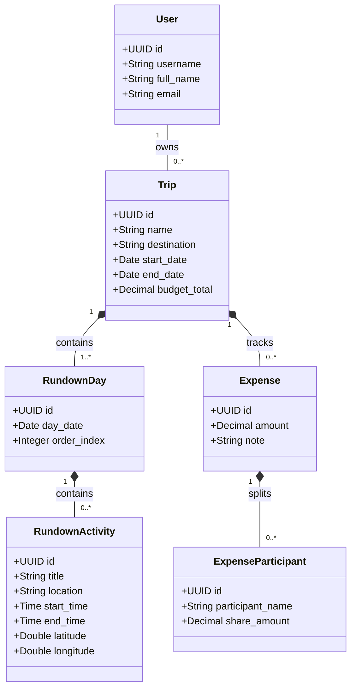
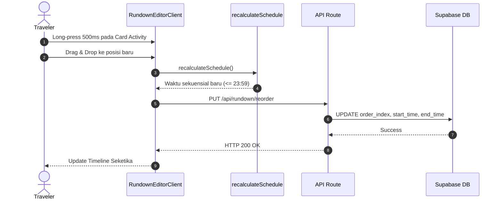

# Product Requirements Document (PRD) & Diagram Arsitektur
## Voluntrip - Aplikasi Perencanaan Trip, Rundown & Budgeting

Dokumen ini berisi **Product Requirements Document (PRD)** lengkap beserta diagram **PlantUML** (`.puml`) dan visualisasi **Mermaid** interaktif (Class Diagram, Use Case Diagram, Sequence Diagram, & Activity Diagram).

👉 **[Lihat Dokumen PRD Lengkap (PRD.md)](./PRD.md)**

---

## 📂 File Sumber PlantUML (.puml)
Seluruh file mentah PlantUML tersimpan di folder `prd/diagrams/`:
* 📐 **Class Diagram**: [`prd/diagrams/class_diagram.puml`](./diagrams/class_diagram.puml)
* 🎭 **Use Case Diagram**: [`prd/diagrams/usecase_diagram.puml`](./diagrams/usecase_diagram.puml)
* 🔄 **Sequence Diagram (Drag & Reschedule)**: [`prd/diagrams/sequence_drag_reschedule.puml`](./diagrams/sequence_drag_reschedule.puml)
* 🔐 **Sequence Diagram (Login & Auth)**: [`prd/diagrams/sequence_login.puml`](./diagrams/sequence_login.puml)
* 🔀 **Activity Diagram**: [`prd/diagrams/activity_diagram.puml`](./diagrams/activity_diagram.puml)

---

## 📊 Visualisasi Diagram Langsung (GitHub Render)

### 1. Class Diagram

### 2. Sequence Drag & Drop Auto-Reschedule

